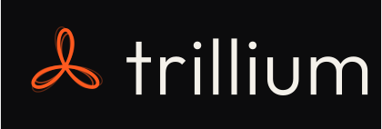
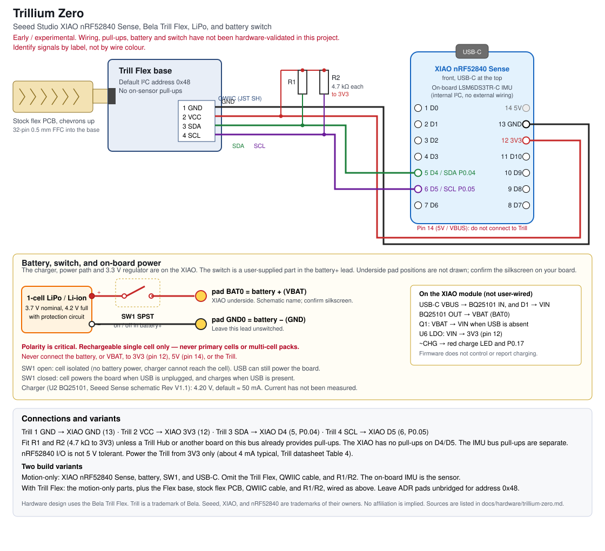
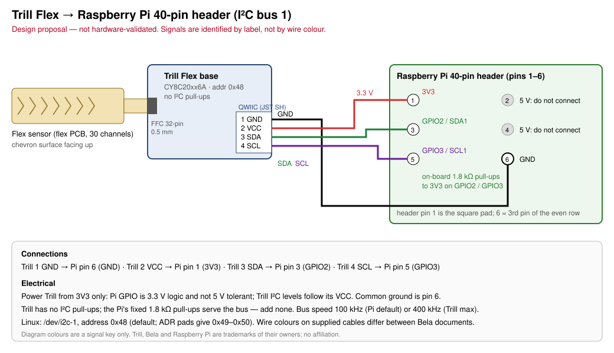

<picture>
  <source media="(prefers-color-scheme: light)" srcset="brand/wordmark/lockup-on-warm-white.svg">
  
</picture>

# Using the Trill

Open hardware designs and Rust software for musical instruments that start with one inexpensive microcontroller and a free app.

**Trillium Zero (T0)** is the starting point: one [Seeed Studio XIAO nRF52840 Sense](https://www.seeedstudio.com/Seeed-XIAO-BLE-Sense-nRF52840-p-5253.html) on a USB-C cable. It sends class-compliant USB-MIDI from its onboard motion sensor. The free [Trillium](docs/apple-app.md) app (Mac, iPhone and iPad) configures and monitors it. The board is small and suits many DIY cases and packaging ideas.

Later models add a battery and Bluetooth (T1), a better LED and buttons (T2), and a [Bela Trill Flex](https://bela.io/trill) linear touch sensor (F1). Other combinations are possible; a board is described by its model and a list of capabilities. See the [model lineup](hardware/README.md).

Trillium is the Apple app. Trill is the name of the firmware, this repository, and Bela's touch-sensor product.

> **Status (0.4.0, unreleased):** the wiring designs are proposals. The Rust driver, Linux CLI, IMU driver, MIDI event engine, configuration protocol, motion synth and XIAO Sense USB-MIDI firmware build and pass host tests. The Mac and iPhone companion app **Trillium** (TrillKit + SwiftUI) builds unsigned in CI and has a live **Sensors** tab (acceleration, rotation, orientation, touch, stream health) and a MIDI monitor/log; CI also produces a test kit with the Mac app and the matching firmware ([kit](docs/test-kit.md)). Firmware 0.2.0 has run on one XIAO nRF52840 Sense (IMU working, USB-MIDI and configuration protocol checked from a Mac; no Trill sensor attached). Firmware 0.3.0 (sensor telemetry, Sensors tab, tap percussion) has run on that board from a Mac. Firmware 0.4.0 adds sensor modes (tilt notes, theremin), configurable controllers, tap sensitivity and optional flick gestures ([mapping](docs/midi-mapping.md#sensor-modes-and-controllers-firmware-040)) and fixes taps stopping after 35.8 min; these are simulation-tested only and have not run on hardware. The iPhone app has not run on hardware. See [design status](docs/roadmap.md#design-status).

## Designs

| Design | What it is | Document |
|---|---|---|
| **Trillium Zero (T0)** | One Seeed Studio XIAO nRF52840 Sense on a USB-C cable. USB-MIDI from the onboard IMU. The showcase starting point. | [docs/hardware/trillium-zero.md](docs/hardware/trillium-zero.md) |
| Model lineup (T0, T1, T2, F1) | T0 plus battery and BLE (T1), a better LED and buttons (T2), and a Bela Trill Flex linear touch sensor (F1). Other combinations are possible. | [hardware/README.md](hardware/README.md) |
| Trill Flex → Seeed Studio XIAO nRF52840 | Wiring notes for D4/D5, pull-ups, and the on-board charger. Used for breadboard Flex testing and in the planned F1. | [docs/design-xiao-nrf52840.md](docs/design-xiao-nrf52840.md) ([power and battery](docs/design-xiao-nrf52840.md#power-usb-and-battery)) |
| Trill Flex → Raspberry Pi | Pi 40-pin header, I²C bus 1, Linux | [docs/design-raspberry-pi.md](docs/design-raspberry-pi.md) |

[](docs/hardware/trillium-zero.md)

[](docs/design-raspberry-pi.md)

## Documentation

- [USB MIDI](docs/usb-midi.md): what the XIAO presents to macOS/iOS, setup, hardware acceptance procedure, latency targets.
- [Apple app (Mac + iPhone)](docs/apple-app.md): **Trillium**, the companion app: device, monitor, mapping, presets, Mac firmware assistant; build, run, sign with your own team.
- [Configuration protocol](docs/config-protocol.md): versioned SysEx protocol on the second USB-MIDI port, with shared test vectors.
- [MIDI mapping](docs/midi-mapping.md): touch and motion events → MIDI messages, priorities, reconnect/panic, example trace.
- [Trillium Zero](docs/hardware/trillium-zero.md): the T0 starting instrument — one XIAO nRF52840 Sense on a USB cable — and optional later-model additions. This page is hardware only.
- [Hardware model lineup](hardware/README.md): T0, T1, T2 and F1, with the revision A T2/F1 designs.
- [XIAO nRF52840 Sense firmware](docs/firmware-xiao-sense.md): build, safe UF2 loading with backup/restore, USB diagnostics, bring-up checklist, latency measurement.
- [Motion-to-music engine](docs/motion-synth.md): motion processing, and the optional on-board debug synth.
- [Current design and status](docs/current-design.md): block diagram, real rates, what is compiled, tested or untested, known limitations.
- [Mac/iPhone connectivity plan](docs/music-connectivity.md): USB-MIDI vs BLE-MIDI vs custom, product precedents, latency targets and test plan.
- [Omi integration](docs/omi-integration.md): what Omi's DevKit firmware does, licences by component, reuse matrix, architecture decision.

- [Protocol notes](docs/protocol.md): I²C memory map, commands, data formats, and scaling.
- [Building](docs/build.md): host checks and cross-compiling (Pi Zero ARMv6, 64-bit Pi, Cortex-M4F).
- [Releasing and deployment](docs/releasing.md): release workflow, artifacts, checksums, installing on a Pi or ZPOD.
- [Roadmap and design status](docs/roadmap.md): instrument pipeline, model lineup, planned UI terms, device identification, BLE-MIDI, microphone.
- [Microphone research](docs/research/microphone.md): next-release test path for the Sense PDM mic (chart and Mac play-through), with rates, transports and constraints.
- [Changelog](CHANGELOG.md)

## Software

| Crate | Path | Description |
|---|---|---|
| `trill-driver` | [crates/trill-driver](crates/trill-driver) | `no_std` driver on `embedded-hal` 1.0 (`I2c` + `DelayNs`). Identify, configure, and read centroid or 16-bit channel frames. |
| `trill-cli` (binary `trill`) | [crates/trill-cli](crates/trill-cli) | Linux bring-up tool over `/dev/i2c-N` (`linux-embedded-hal`). |
| `lsm6ds3trc` | [crates/lsm6ds3trc](crates/lsm6ds3trc) | `no_std` LSM6DS3TR-C accelerometer + gyroscope driver (the XIAO Sense IMU). |
| `motion-synth` | [crates/motion-synth](crates/motion-synth) | `no_std` motion processing, gesture mapping and audio-rate synth. |
| `instrument-events` | [crates/instrument-events](crates/instrument-events) | `no_std` touch + motion → MIDI 1.0 event engine (single voice) and USB-MIDI packet encoder. |
| `trill-usb` | [crates/trill-usb](crates/trill-usb) | USB-MIDI + CDC device layout (embassy-usb) with host descriptor tests. |
| `trill-config` | [crates/trill-config](crates/trill-config) | `no_std` SysEx configuration protocol v1 (device handler, host encoders, bounded USB-MIDI SysEx assembly) and [test vectors](protocol/config-v1-vectors.txt). |
| `status-led` | [crates/status-led](crates/status-led) | `no_std` RGB status LED: prioritised indications, blink timing, debug override, embedded-hal pin driver. |
| `xiao-sense-fw` | [firmware/xiao-sense](firmware/xiao-sense) | Embassy firmware for the XIAO nRF52840 Sense: USB-MIDI + diagnostics; optional debug synth (separate workspace). |
| Trillium app + `TrillKit` | [apple](apple) | SwiftUI app for macOS 13+ and iOS 16+ and its Swift package (protocol, CoreMIDI, monitor, presets, UF2 checks). Xcode project generated by XcodeGen. |
| tools | [tools](tools) | `xiao_uf2.py` (application-only UF2 convert/inspect/backup/flash), `pcm_capture.py` (USB PCM stream → WAV). |

Quick start on a Raspberry Pi with I²C enabled:

```sh
trill identify                 # expected: Trill Flex at 0x48 on /dev/i2c-1, firmware 3
trill read                     # centroid mode: touch positions 0.0..1.0 and sizes
trill read --mode diff         # 30 per-channel values (custom flex sensors)
trill --address 0x49 --bus /dev/i2c-3 read --count 100
```

Build and check locally (no hardware needed):

```sh
make ci          # fmt, clippy -D warnings, tests, tool tests, thumbv7em libs, firmware link + UF2 check
make pi-zero     # static ARMv6 binary for Pi Zero / Zero W (needs cargo-zigbuild)
make fw-uf2      # XIAO Sense USB-MIDI firmware -> dist/*.uf2 (validated; never written to a device)
make synth-demo  # render the motion synth demo to dist/motion-synth-demo.wav
```

On a Mac with Xcode 16+ and XcodeGen 2.45.4 ([details](docs/apple-app.md)):

```sh
make apple-test        # TrillKit tests (protocol vectors, sessions, UF2 checks)
make apple-mac         # unsigned macOS app -> build/apple
make apple-ios-sim     # iOS Simulator app
make apple-project && open apple/Trillium.xcodeproj   # run, or sign with your own team
```

## Licence

Copyright © 2026 Nymble ([@nymble](https://github.com/nymble)).

This project is dual-licensed: you may use it under the GNU GPL v3.0 only or under a commercial license from M-of-N. For commercial terms, contact <https://m-of-n.com/contact>.

- Code, documentation, and diagrams in this repository: [GNU GPL v3.0 only](LICENSE) (`SPDX-License-Identifier: GPL-3.0-only`).
- Commercial or proprietary licensing on separate terms: see [COMMERCIAL-LICENSE.md](COMMERCIAL-LICENSE.md).
- Third-party names, references, and attributions: see [NOTICE.md](NOTICE.md).

This project is not affiliated with or endorsed by Bela / Augmented Instruments Ltd., Seeed Studio, Nordic Semiconductor, Raspberry Pi Ltd., or Based Hardware (Omi).
