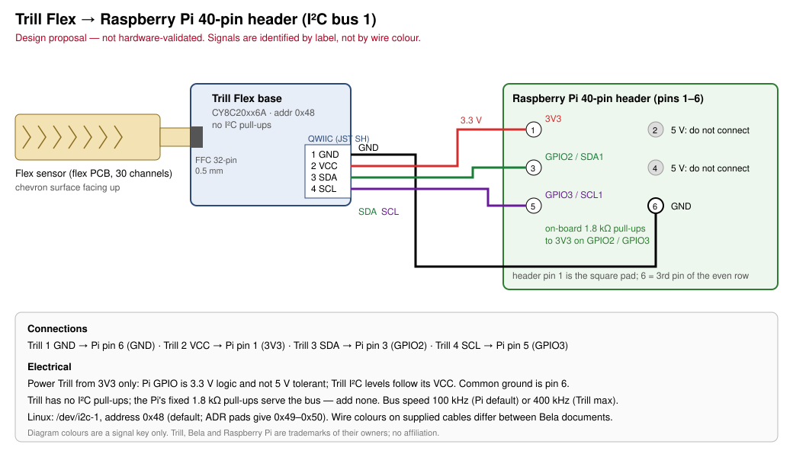
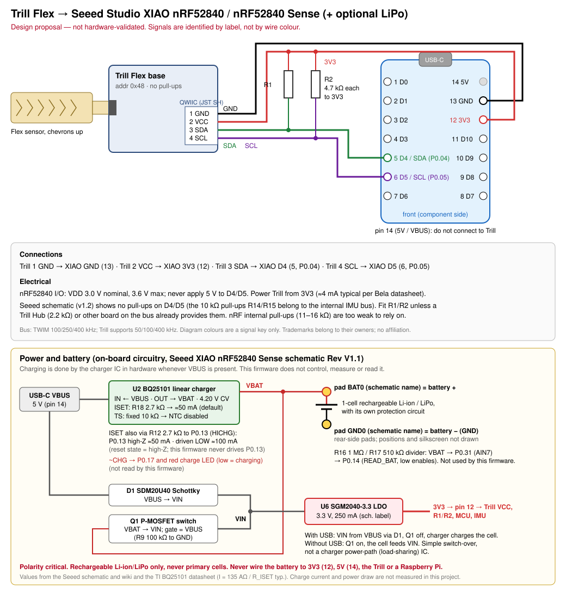

# Using the Trill

Open hardware designs and Rust software for using [Bela Trill](https://bela.io/trill) capacitive touch sensors, starting with **Trill Flex**, as a musical instrument controller.

> **Status (v0.1.0):** the wiring designs are proposals and have **not been validated on hardware**. The Rust driver and Linux CLI build and pass host tests against the datasheet protocol. Nothing has been run against a physical sensor yet. See [design status](docs/roadmap.md#design-status).

## Designs

| Design | Host | Document |
|---|---|---|
| Trill Flex → Raspberry Pi | Pi 40-pin header, I²C bus 1, Linux | [docs/design-raspberry-pi.md](docs/design-raspberry-pi.md) |
| Trill Flex → Seeed Studio XIAO nRF52840 | XIAO D4/D5, Cortex-M4F, BLE-capable | [docs/design-xiao-nrf52840.md](docs/design-xiao-nrf52840.md) |

[](docs/design-raspberry-pi.md)

[](docs/design-xiao-nrf52840.md)

## Documentation

- [Protocol notes](docs/protocol.md): I²C memory map, commands, data formats, and scaling.
- [Building](docs/build.md): host checks and cross-compiling (Pi Zero ARMv6, 64-bit Pi, Cortex-M4F).
- [Releasing and deployment](docs/releasing.md): release workflow, artifacts, checksums, installing on a Pi or ZPOD.
- [Roadmap and design status](docs/roadmap.md): instrument pipeline, synth/MIDI, BLE, Contrail, ZPOD.
- [Changelog](CHANGELOG.md)

## Software

| Crate | Path | Description |
|---|---|---|
| `trill-driver` | [crates/trill-driver](crates/trill-driver) | `no_std` driver on `embedded-hal` 1.0 (`I2c` + `DelayNs`). Identify, configure, and read centroid or 16-bit channel frames. |
| `trill-cli` (binary `trill`) | [crates/trill-cli](crates/trill-cli) | Linux bring-up tool over `/dev/i2c-N` (`linux-embedded-hal`). |

Quick start on a Raspberry Pi with I²C enabled:

```sh
trill identify                 # expected: Trill Flex at 0x48 on /dev/i2c-1, firmware 3
trill read                     # centroid mode: touch positions 0.0..1.0 and sizes
trill read --mode diff         # 30 per-channel values (custom flex sensors)
trill --address 0x49 --bus /dev/i2c-3 read --count 100
```

Build and check locally (no hardware needed):

```sh
make ci          # fmt check, clippy -D warnings, tests, thumbv7em driver build
make pi-zero     # static ARMv6 binary for Pi Zero / Zero W (needs cargo-zigbuild)
```

## Licence

Copyright © 2026 Nymble ([@nymble](https://github.com/nymble)).

- Code, documentation, and diagrams in this repository: [GNU GPL v3.0 only](LICENSE) (`SPDX-License-Identifier: GPL-3.0-only`).
- Commercial or proprietary licensing on separate terms: see [COMMERCIAL-LICENSE.md](COMMERCIAL-LICENSE.md).
- Third-party names, references, and attributions: see [NOTICE.md](NOTICE.md).

This project is not affiliated with or endorsed by Bela / Augmented Instruments Ltd., Seeed Studio, Nordic Semiconductor, or Raspberry Pi Ltd.
