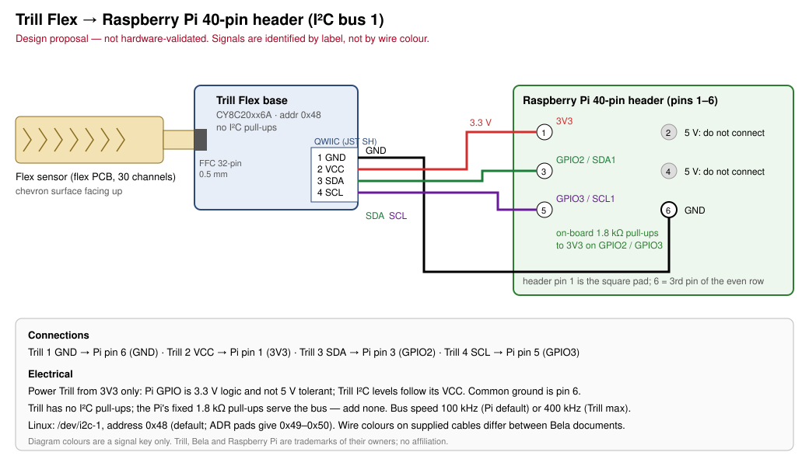

# Design: Trill Flex → Raspberry Pi

**Status:** design proposal, **not hardware-validated**. Pin facts are taken from the sources listed at the end of this document.

## Scope

This design connects one Trill Flex (base and stock flex sensor) to I²C bus 1 on any Raspberry Pi with the 40-pin header (Pi Zero/Zero W/Zero 2 W, Pi 2–5). The host software is the `trill` CLI or an application built on `trill-driver`.

## Pin mapping

The Trill QWIIC receptacle (JST SH, 4-pin, 1 mm pitch) has pins numbered 1–4 from left to right when facing the receptacle (datasheet Table 3).

| Trill pin | Signal | Pi header pin | Pi function |
|---|---|---|---|
| 1 | GND | **6** (or any GND: 9, 14, 20, 25, 30, 34, 39) | Ground |
| 2 | VCC | **1** (or 17) | 3V3 |
| 3 | SDA | **3** | GPIO2 / SDA1 |
| 4 | SCL | **5** | GPIO3 / SCL1 |

Do **not** connect pins 2 or 4 (5 V).

**Wire colours are not authoritative.** Bela's datasheet (Table 3) lists SDA = blue and SCL = yellow for the supplied cable. The *Get started with Trill* page lists SCL = blue and SDA = white. Identify each wire by the pin position or by the labels next to the connector on the sensor, and check continuity with a meter before applying power.

## Electrical

| Parameter | Value | Source |
|---|---|---|
| Trill VCC range | 1.71–5.5 V (PSoC rating); Bela-tested at 3.3 V and 5 V | Datasheet Table 4 |
| Supply in this design | **3.3 V from Pi pin 1** | Pi GPIO is 3.3 V logic and not 5 V tolerant |
| Trill current | 4 mA typical | Datasheet Table 4 |
| Ground | Common ground between Trill and Pi (pin 6) | — |
| I²C pull-ups | None on Trill. Pi has fixed **1.8 kΩ** pull-ups to 3.3 V on GPIO2/GPIO3; add no external resistors | Datasheet §7; Raspberry Pi GPIO docs |
| I²C speed | Trill: 50/100/400 kHz. Pi default 100 kHz | Datasheet Table 4; Pi overlay README |
| Address | **0x48** (Flex default) | Datasheet Table 8 |

I²C logic levels follow Trill VCC, so powering Trill from 3.3 V keeps SDA/SCL within the Pi's limits. Never power Trill from 5 V while it is connected to Pi GPIO.

### Address selection

The ADR0/ADR1 solder-pad groups on the back of the base add an offset of +0 to +8, giving 0x48–0x50 (datasheet Table 8). In each group, bridge the middle pad to **one** side only; bridging both sides shorts VCC to GND. Check with a meter before powering. 0x50 (+8) can collide with other devices; avoid it when other I²C parts share the bus.

## Flex sensor attachment

The base has a 32-pin, 0.5 mm pitch FFC connector. Per datasheet §8.6:

1. Hold the base facing up with the Trill logo at the top. The connector is on the right side.
2. Open the gate by gently pulling it towards the side of the PCB.
3. Hold the sensor with the chevron-pattern touch surface facing up and insert it fully.
4. Close the gate and give the sensor a gentle tug to check it is held.

Until this has been checked on the actual unit, compare the orientation with the datasheet figures before closing the gate. A reversed or partly inserted tail gives missing or nonsensical channels, not an obvious fault.

## Stock strip vs custom sensors

| Sensor | Mode | Output |
|---|---|---|
| Stock 1-axis flex strip (30 channels in order) | `centroid` (default) | Up to 5 touches. Location 0–3712 (normalised 0.0–1.0), size uncalibrated |
| Custom flex PCB (buttons, non-linear layout) | `diff` | 30 per-channel activation values. Grouping and centroiding are done on the host |

Centroid mode assumes the channels are wired to pads in sequential linear order (datasheet §6.1). See [protocol.md](protocol.md) for data formats and scaling.

## Bill of materials

| Qty | Item | Notes |
|---|---|---|
| 1 | Bela Trill Flex (base + flex sensor) | Manufacturer number 160706-FLEX |
| 1 | QWIIC-to-pin cable | Supplied with Trill Flex |
| 1 | Raspberry Pi with 40-pin header | Pi Zero W used by the ZPOD host |
| — | 2.54 mm header on the Pi, or direct soldering | Zero boards ship without a header |

No resistors are required for a single Trill on the Pi's bus 1.

## Bring-up

1. With power off, wire as tabled above and verify continuity.
2. Enable I²C: `dtparam=i2c_arm=on` in `/boot/firmware/config.txt` (Bookworm) or `/boot/config.txt` (older images), or use `raspi-config` → Interface Options → I2C. Optional: `dtparam=i2c_arm_baudrate=400000`. Reboot.
3. `ls /dev/i2c-1`, then `i2cdetect -y 1` (package `i2c-tools`): expect `48`.
4. `trill identify`: expect `Trill Flex at 0x48 on /dev/i2c-1, firmware 3`.
5. `trill read` with hands off the sensor during the baseline update, then touch the strip. Location should run 0.0 → 1.0 along the strip.
6. For custom sensors: `trill read --mode diff`.

The user needs read/write access to `/dev/i2c-1`, for example through membership of the `i2c` group on Raspberry Pi OS.

## Known limits

- Not yet tested on hardware: the pin mapping, cable colour, and FFC orientation have not been checked on a physical Trill Flex.
- Linux I²C reads are polled. The CLI uses a fixed interval (default 20 ms) and does not yet use the status-byte frame counter or the EVT pin.
- The driver decodes 16-bit channel data only; it does not handle the 8/12-bit Format settings. 2-axis sensors (Square/Hex) are not decoded in centroid mode.
- Long or unshielded I²C wiring reduces margin. Keep the leads short, and fall back to 100 kHz if reads fail.

## ZPOD host compatibility

ZPOD is a host built around a Raspberry Pi Zero W. The facts below were reported by the ZPOD project and are not verified here.

| Item | ZPOD |
|---|---|
| Board | Raspberry Pi Zero W Rev 1.1, single-core ARMv6, 512 MB |
| OS | Custom Buildroot fast-boot image (read-only squashfs root + `/data`, BusyBox) or a trimmed pi-gen Raspberry Pi OS (Bookworm). Not RetroPie |
| I²C bus 1 (GPIO2/3) | Enabled and **shared**: `0x4D` PCM5122 DAC, `0x36` MAX17048 fuel gauge, `0x68` DS3231 RTC (kernel driver) |
| Trill address | Default **0x48** does not conflict. **Never** strap the Flex to 0x4D (ADR1 = GND, ADR0 = VCC, +5) |
| Pull-ups | Pi on-board 1.8 kΩ already present; add none |
| Physical access | Whether header pins 1/3/5/6 can be reached inside the closed case has **not been checked** |
| Toolchain | Rust `arm-unknown-linux-musleabihf` (ARMv6, *not* ARMv7) via `cargo-zigbuild`; apps ship as `.zpa` bundles |
| Audio | PCM5122 over I²S (ALSA). MPD currently has exclusive use of the DAC, so a synth needs a future shared-audio arrangement |

The `trill` binary built with `make pi-zero` is a static ARMv6 hard-float executable and needs no system libraries. Packaging as a `.zpa` bundle belongs to the ZPOD project and is not done here. See [roadmap.md](roadmap.md#zpod).

## Sources

- Trill datasheet Rev C v1.3 (2025-02-03): <https://github.com/BelaPlatform/Trill/raw/master/trill_datasheet.pdf>. Table 3 (pinout), Table 4 (electrical), §7 (I²C, pull-ups, addresses), §8.6 (Flex connector)
- Get started with Trill: <https://learn.bela.io/using-trill/get-started-with-trill/>
- All about I²C (Trill): <https://learn.bela.io/using-trill/all-about-i2c/>
- Working with Trill Flex: <https://learn.bela.io/using-trill/working-with-trill-flex/>
- Raspberry Pi GPIO (1.8 kΩ pull-ups, 3.3 V logic): <https://www.raspberrypi.com/documentation/computers/raspberry-pi.html#gpio>
- Raspberry Pi `i2c_arm` / `i2c_arm_baudrate`: <https://github.com/raspberrypi/firmware/blob/master/boot/overlays/README>
- Reference host library: <https://github.com/BelaPlatform/Trill-Linux>
