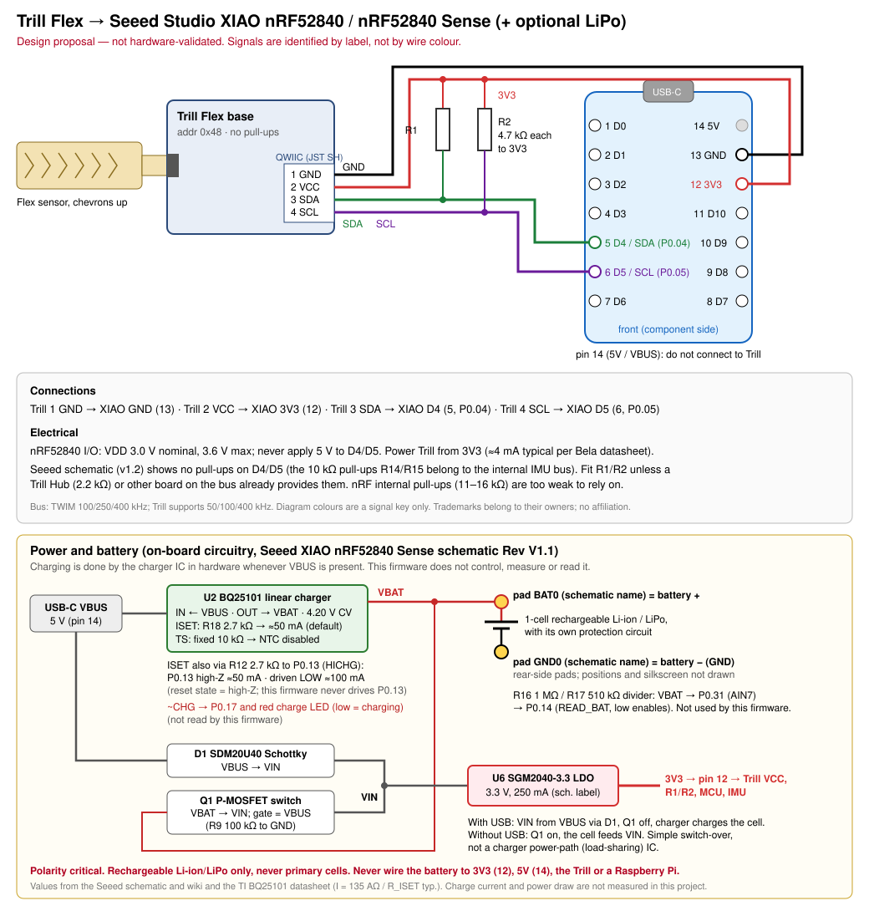

# Design: Trill Flex → Seeed Studio XIAO nRF52840

**Status:** design proposal, **not hardware-validated**. No firmware for this board is included yet; see [Firmware bring-up plan](#firmware-bring-up-plan).

## Scope

This design connects one Trill Flex to the XIAO's I²C pins. It applies to the **XIAO nRF52840** and **XIAO nRF52840 Sense**, which share the same 14-pin edge pinout and the same D4/D5 I²C pins. The *Plus* variants keep D4/D5 as SDA/SCL but add pins; their extra pins are not covered here.

The MCU is a Nordic nRF52840 (Arm Cortex-M4F, 64 MHz, Bluetooth LE). It has **no Wi-Fi**. ESP32 pin and bus conventions do not apply.

## Pin mapping

| Trill pin | Signal | XIAO pin | XIAO name | nRF52840 pin |
|---|---|---|---|---|
| 1 | GND | 13 | GND | — |
| 2 | VCC | 12 | 3V3 (3V3_OUT) | — |
| 3 | SDA | 5 | D4 / SDA | P0.04 |
| 4 | SCL | 6 | D5 / SCL | P0.05 |
| — | — | 14 | 5V (VBUS) | **do not connect to Trill** |

Pin numbers follow the XIAO symbol in Seeed's schematic: pins 1–7 = D0–D6 down one edge, 8–11 = D7–D10, 12 = 3V3, 13 = GND, 14 = 5V. In the diagram the board is seen from the front with USB-C at the top. Check against the Seeed pinout sheet before soldering.

Wire colours are not authoritative (see [the Raspberry Pi design](design-raspberry-pi.md#pin-mapping)). Identify each signal by position or label.

## Electrical

| Parameter | Value | Source |
|---|---|---|
| nRF52840 VDD | 1.7–3.6 V, 3.0 V nominal. XIAO supplies 3.3 V | nRF52840 PS v1.5 |
| I/O voltage | VDD + 0.3 V max: **not 5 V tolerant** | nRF52840 PS v1.5 |
| Trill supply | **XIAO 3V3** (pin 12). Trill draws about 4 mA | Trill datasheet Table 4 |
| Ground | Common ground (pin 13) | — |
| Address | 0x48 | Trill datasheet Table 8 |
| I²C controller | TWIM, 100/250/400 kbps. Trill supports 50/100/400 kHz, so use **100 or 400 kHz** | nRF52840 PS v1.5; Trill datasheet |

### Pull-up resistors

The Trill sensor has **no** I²C pull-ups (datasheet §7). Seeed's schematics (XIAO nRF52840 v1.2 and Sense) show **no pull-up resistors on the D4/D5 nets**. The 10 kΩ resistors R14/R15 pull up the separate internal IMU bus and are powered from the IMU supply. The nRF52840 internal GPIO pull-ups are 11–16 kΩ (PS v1.5), which is weaker than Bela's recommended 2.2–4.7 kΩ.

The design therefore includes **R1 = 4.7 kΩ from SDA (D4) to 3V3** and **R2 = 4.7 kΩ from SCL (D5) to 3V3**, in line with Bela's guidance (*All about I²C*). Fit only one pair per bus. Omit them if a Trill Hub (2.2 kΩ) or another board on the same bus already provides pull-ups.

Checks before power-up:
1. With the board unpowered, measure D4→3V3 and D5→3V3. You should read about 4.7 kΩ with R1/R2 fitted, and high resistance without them, which confirms there are no on-board pull-ups.
2. Confirm 3V3 and GND are not shorted, and that no ADR pads on the Trill base are bridged to both sides.

The current capability of the XIAO 3V3 output is not stated on the Seeed wiki page cited here. A single Trill (about 4 mA) is a small load, but check the regulator's datasheet before adding other loads to the rail.

## Flex sensor attachment, modes, and address

These are the same as in the Raspberry Pi design: [FFC attachment](design-raspberry-pi.md#flex-sensor-attachment), [stock vs custom sensors](design-raspberry-pi.md#stock-strip-vs-custom-sensors), [address selection](design-raspberry-pi.md#address-selection). The stock strip uses `Mode::Centroid`; custom flex PCBs use `Mode::Diff`.

## Bill of materials

| Qty | Ref | Item | Notes |
|---|---|---|---|
| 1 | — | Bela Trill Flex (base + flex sensor) | 160706-FLEX |
| 1 | — | QWIIC-to-pin cable | Supplied with Trill Flex |
| 1 | U1 | Seeed Studio XIAO nRF52840 or nRF52840 Sense | — |
| 2 | R1, R2 | 4.7 kΩ resistor, 1/8 W or larger, 5 % or better | SDA and SCL to 3V3 |
| — | — | Headers or wire, optional LiPo cell | Battery charging is handled by the on-board BQ25101 (not used by this design) |

## Firmware bring-up plan

`trill-driver` is `no_std`, uses only the `embedded-hal` 1.0 `I2c` and `DelayNs` traits, and compiles for `thumbv7em-none-eabihf` (checked in CI). Any nRF52840 HAL that implements these traits can drive it. Firmware has not been written or flashed yet. Planned stages:

1. **Toolchain:** `rustup target add thumbv7em-none-eabihf`, then `make check-thumb`. This works today.
2. **Blink + log:** a minimal firmware crate (planned: Embassy `embassy-nrf` with the `nrf52840` feature) that blinks the user LED and logs over USB CDC or RTT. Still to decide: the flashing route (the factory UF2 bootloader, entered by double-pressing reset per the Seeed wiki, or SWD with a debug probe) and the memory layout that keeps the bootloader intact.
3. **I²C bus:** TWIM on P0.04 (SDA) / P0.05 (SCL) at 100 kHz with external R1/R2. Probe 0x48.
4. **Trill:** `Trill::new(twim, 0x48)`, then `init(.., Some(Device::Flex), &Config::for_device(Device::Flex))`, then poll `read_touches()` at roughly 100 Hz.
5. **Transport (future):** a BLE GATT or BLE-MIDI service carrying touch events to iPhone/iPad. Not designed yet; see [roadmap.md](roadmap.md).

## Known limits

- Wiring, pull-up values, and orientation have not been tested on hardware.
- No firmware binary, BLE service, or mobile app exists yet.
- The *Plus* variants and the XIAO expansion board are not covered.

## Sources

- Seeed Studio XIAO nRF52840 series wiki (pin map, interfaces): <https://wiki.seeedstudio.com/XIAO_BLE/>
- XIAO nRF52840 schematic v1.2: <https://files.seeedstudio.com/wiki/XIAO-BLE/Res/260828_XIAO_nRF52840.pdf>
- XIAO nRF52840 Sense schematic: <https://files.seeedstudio.com/wiki/XIAO-BLE/Seeed_Studio_XIAO_nRF52840_PDF.pdf>
- Nordic nRF52840 Product Specification v1.5 (VDD, I/O limits, RPU, TWIM): <https://files.seeedstudio.com/wiki/XIAO-BLE/nRF52840_PS_v1.5.pdf>
- Trill datasheet Rev C v1.3: <https://github.com/BelaPlatform/Trill/raw/master/trill_datasheet.pdf>
- All about I²C (Trill, pull-up guidance): <https://learn.bela.io/using-trill/all-about-i2c/>
