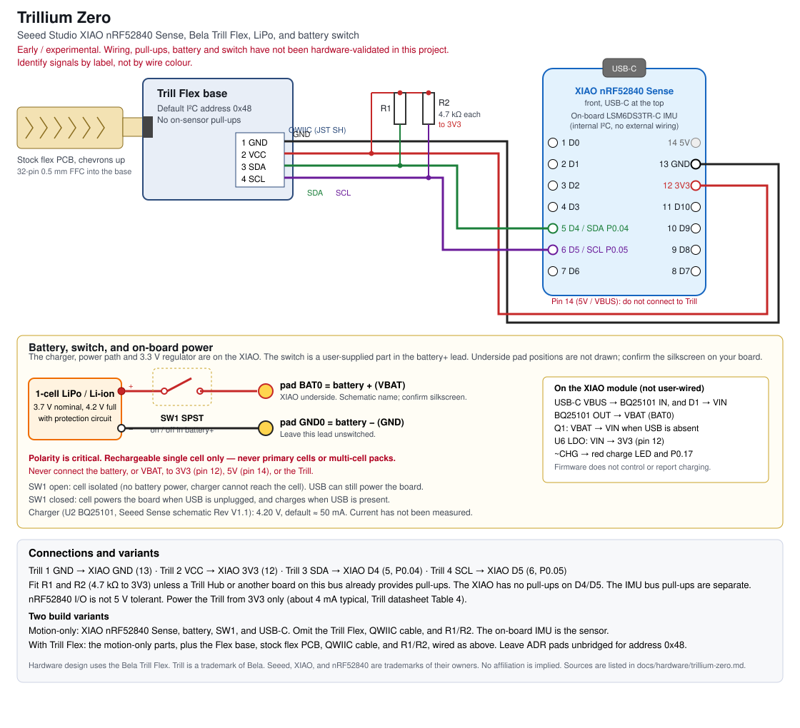

# Trillium Zero

**Model:** T0 · **Status:** the showcase starting instrument, and the primary development configuration to date.

Trillium Zero is one inexpensive part on a USB cable: a [Seeed Studio XIAO nRF52840 Sense](https://www.seeedstudio.com/Seeed-XIAO-BLE-Sense-nRF52840-p-5253.html). Plug it in, install the free open [Trillium](../apple-app.md) app and the matching Trill firmware from the [GitHub Releases](https://github.com/nymble/trill/releases), and it is a class-compliant USB-MIDI motion instrument. The board is 21 × 17.8 mm and suits many DIY cases and packaging ideas. No extra parts are required.

Trillium is the Apple app (Mac, iPhone and iPad). Trill is the name of the firmware, the protocol and this repository, and of Bela's touch-sensor product.

The Sense board already carries an LSM6DS3TR-C motion sensor, a PDM microphone, a Bluetooth LE radio and a Li-ion charger. **T0 uses USB power and USB-MIDI only.** A battery and wireless use are [T1](../../hardware/README.md#model-lineup); a better LED and buttons are T2; a [Bela Trill Flex](https://bela.io/products/trill/) linear touch sensor is F1. Other combinations are possible. Trill is a trademark of Bela.

Firmware 0.6.0 has run on XIAO nRF52840 Sense boards (IMU, USB-MIDI, and on at least one board a Trill Flex was detected). A T1 — T0 plus a battery and BLE, built as an early Omi DIY board — has been used in testing. The optional battery switch and a finished F1 enclosure have not been built from this guide. Do not treat this page as a substitute for the manufacturer datasheets when you are about to solder or apply power.

This page describes the hardware only. Firmware, the Trillium app, and the USB-MIDI mapping live in the rest of this repository and in published GitHub Releases.

The figure is the canonical wiring diagram for this family. **T0 is the XIAO nRF52840 Sense alone.** The battery, the battery switch and the Trill Flex in the drawing are optional later-model or breadboard additions; they are not required to build or use a Trillium Zero. The figure replaces the earlier XIAO wiring drawing. Pad positions on the back of the XIAO are not drawn, because this project has not recorded a measured silkscreen layout; confirm `BAT+` / `BAT−` (schematic names `BAT0` / `GND0`) on your board and on Seeed's underside photograph before soldering a cell.

## Model lineup

| Model | What you build | Status |
|---|---|---|
| **T0 — Trillium Zero** | The Sense board and a USB-C cable. USB-MIDI from the onboard IMU. | Primary development configuration. This is the starting point. |
| **T1** | T0 plus a protected LiPo cell, a battery switch, and BLE. | Built and tested on an early Omi DIY board. Not a new design in this folder. |
| **T2** | T1 plus a better LED and buttons. | Planned. The revision A drawings under [`hardware/t2/`](../../hardware/t2/README.md) are this electronics set. Not built. |
| **F1** | T2 plus a Bela Trill Flex linear touch sensor. | Planned. Only testing to date is a breadboard T0 plus a Trill Flex. Drawings: [`hardware/f1/`](../../hardware/f1/README.md). |

The family, pin maps and revision A files are in the [hardware README](../../hardware/README.md).

The plain XIAO nRF52840 (without Sense) shares the same 14-pin edge pinout and battery pads, but has no IMU and no microphone. T0 needs the **Sense** board. XIAO *Plus* variants also use D4/D5 as SDA/SCL; their extra pins are not used here and are not shown.

## Bill of materials

### T0 — required

| Qty | Item | Notes and links |
|---|---|---|
| 1 | Seeed Studio XIAO nRF52840 Sense | Official product page: [Seeed-XIAO-BLE-Sense-nRF52840-p-5253](https://www.seeedstudio.com/Seeed-XIAO-BLE-Sense-nRF52840-p-5253.html). Wiki and pin map: [XIAO nRF52840 series](https://wiki.seeedstudio.com/XIAO_BLE/) |
| 1 | USB-C cable | Powers the board and carries USB-MIDI to the host |

No enclosure or mounting hardware is specified. That is left to the builder, which is part of the point of T0.

### Optional: battery (toward T1)

| Qty | Item | Notes and links |
|---|---|---|
| 1 | Single-cell rechargeable Li-ion or LiPo, 3.7 V nominal, 4.2 V full charge, **with its own protection circuit** | Capacity is left to the builder. Never use a primary (non-rechargeable) cell or a multi-cell pack. See [Power](#power-charging-and-the-battery-switch) |
| 1 | SPST on/off switch (slide, toggle, or equivalent) | User-supplied. Wire it in series in the **battery+** lead only. Operating current of this build has not been measured; the on-board charger's higher setting is about 100 mA, so choose a switch with comfortable margin above that. No specific part is specified |
| — | Leads or a connector suited to the XIAO rear battery pads | Not specified. Follow Seeed's guidance for the board |

### Optional: Trill Flex (breadboard testing, toward F1)

| Qty | Item | Notes and links |
|---|---|---|
| 1 | Bela Trill Flex (base + stock flex sensor) | Manufacturer number 160706-FLEX. Product family: [bela.io/products/trill](https://bela.io/products/trill/). Flex listing: [shop.bela.io/products/trill-flex](https://shop.bela.io/products/trill-flex) |
| 1 | QWIIC-to-pin cable | Supplied with Trill Flex. Identify each conductor by pin position or by the labels next to the connector, not by colour |
| 2 | 4.7 kΩ resistor, 1/8 W or larger, 5 % or better (R1, R2) | SDA and SCL to 3V3. Omit only if a Trill Hub or another board on the same bus already provides pull-ups |
| — | Headers, hook-up wire, or a small prototyping board, as needed | Optional |

## Pin-by-pin wiring

Pin numbers on the XIAO follow the symbol in Seeed's schematic: pins 1–7 are D0–D6 down one edge, 8–11 are D7–D10, 12 is 3V3, 13 is GND, 14 is 5V. In the diagram the board is seen from the front with USB-C at the top. Check the [Seeed pinout](https://wiki.seeedstudio.com/XIAO_BLE/) before soldering.

T0 uses only the USB-C connector. The IMU is on a separate, internal I²C bus (P0.07 / P0.27, address 0x6A) and is not wired by the builder. The PDM microphone pins are also internal. The microphone is not used by the current firmware; a testing path is planned, see [Microphone research](../research/microphone.md).

### Optional battery (toward T1)

| Connection | XIAO location | Notes |
|---|---|---|
| Battery +  (through SW1) | Underside pad `BAT0` (VBAT) | Schematic name. Confirm silkscreen and pad position on your board |
| Battery −  (unswitched) | Underside pad `GND0` (GND) | Schematic name. Confirm silkscreen and pad position on your board |
| USB host or charger | USB-C | Powers the board and, when SW1 is closed, charges the cell |

### Optional Trill Flex (breadboard, toward F1)

The Trill QWIIC receptacle (JST SH, 4-pin, 1 mm pitch) is numbered 1–4 from left to right when facing the receptacle (Trill datasheet Table 3).

| Trill pin | Signal | XIAO pin | XIAO name | nRF52840 pin |
|---|---|---|---|---|
| 1 | GND | 13 | GND | — |
| 2 | VCC | 12 | 3V3 (3V3_OUT) | — |
| 3 | SDA | 5 | D4 / SDA | P0.04 |
| 4 | SCL | 6 | D5 / SCL | P0.05 |
| — | — | 14 | 5V (VBUS) | **Do not connect to Trill** |

**Wire colours are not authoritative.** Bela's datasheet (Table 3) and the *Get started with Trill* page disagree about the colours of the supplied cable. Identify each signal by position or label, and check continuity with a meter before applying power.

#### I²C address

The stock Flex default is **0x48** (datasheet Table 8; `DEFAULT_FLEX_ADDRESS` in `crates/trill-driver`). Leave the ADR0 / ADR1 solder pads on the back of the base unbridged for that address. Each pad group can add an offset of +0 to +8 (0x48–0x50). In each group, bridge the middle pad to **one** side only; bridging both sides shorts VCC to GND. Check with a meter before powering.

#### Pull-up resistors

The Trill sensor has no I²C pull-ups (datasheet §7). Seeed's schematics (XIAO nRF52840 v1.2 and Sense) show no pull-ups on the D4/D5 nets. The 10 kΩ resistors R14/R15 on the Sense board belong to the internal IMU bus. The nRF52840 internal GPIO pull-ups are 11–16 kΩ (Product Specification v1.5), which is weaker than Bela's recommended 2.2–4.7 kΩ.

Fit **R1 = 4.7 kΩ from SDA (D4) to 3V3** and **R2 = 4.7 kΩ from SCL (D5) to 3V3**. Fit only one pair per bus. Omit them if a Trill Hub (2.2 kΩ) or another board on the same bus already provides pull-ups. T0 has no external I²C device on D4/D5, so R1 and R2 are not used until a Flex is attached.

## Power, charging, and the battery switch

T0 runs from USB. The rest of this section is for builders who add a cell (toward T1).

The XIAO nRF52840 Sense can run from USB, from one rechargeable lithium cell on its rear battery pads, or both. **Charging is done entirely by on-board hardware** (TI BQ25101) whenever USB VBUS is present. It needs no firmware, and this project's firmware does not control it. Since the battery-status change (see [battery.md](../battery.md)) the firmware **measures and reports** the battery voltage, charge status and presence, but does not change how the charger works. The table is transcribed from the Seeed **XIAO nRF52840 Sense schematic, Rev V1.1** (sheet 3, "Battery charge" and "System 3.3V"). Check the revision printed on your board's documentation; other revisions may differ.

| Block | Part (schematic) | What it does |
|---|---|---|
| Charger | U2 **BQ25101** (`BQ25101YFPT`) | Linear single-cell Li-ion charger. IN = VBUS, OUT = VBAT. Regulation (full-charge) voltage **4.20 V** (BQ25101; the `H` variant would be 4.35 V). Fixed 10-hour safety timer, input over-voltage protection at 6.5 V, thermal regulation (TI datasheet) |
| Charge current | ISET: R18 2.7 kΩ to GND, plus R12 2.7 kΩ to **P0.13** (`HICHG`) | I = KISET / RISET, KISET = 135 AΩ typ. (129–145). P0.13 high-impedance: 2.7 kΩ → **≈ 50 mA** (≈ 48–54 mA). P0.13 driven low: 1.35 kΩ → **≈ 100 mA** (≈ 96–107 mA). Seeed's wiki gives the same 50/100 mA figures. These are fast-charge (constant-current) values; current tapers near full |
| Battery temperature | TS: R20 fixed 10 kΩ to GND | NTC monitoring **disabled** (schematic note). The board does not measure cell temperature |
| Charge status | `~CHG` → **P0.17** and the red charge LED (R5 2.2 kΩ) | Low while charging (Seeed wiki). Hardware-driven; not a firmware status light |
| Battery sense | R16 1 MΩ / R17 510 kΩ from VBAT to **P0.14** (`READ_BAT`), tap to **P0.31** (AIN7) | Read once a second (AIN7, 12 bit). The firmware drives P0.14 **low from boot and never releases it**: Seeed warns that P0.14 high (or floating) can push P0.31 past its 3.6 V limit while the battery charges |
| Battery ↔ USB switch-over | Q1 P-MOSFET (VBAT → VIN, gate = VBUS) and D1 Schottky (VBUS → VIN) | With USB: the system runs from VBUS through D1, Q1 is off, and the charger charges the cell (if SW1 is closed). Without USB: Q1 conducts and the cell feeds VIN. This is a simple switch-over, not a charger with an integrated power path |
| 3.3 V rail | U6 **SGM2040-3.3** LDO, VIN → 3V3 | Labelled 3.3 V / 250 mA on the schematic. 3V3 is pin 12, which powers the Trill and R1/R2 when those are fitted |

The firmware drives P0.14 low (battery-sense divider on, required for safety while charging), reads P0.31 with the SAADC and P0.17 as an input without pull, and never configures P0.13, which stays in the nRF52840 reset state (input, disconnected), so the charger runs at the ≈ 50 mA setting. Firmware 0.7.0 and earlier left P0.14 floating. Battery presence on USB power is a heuristic with known limits; see [battery.md](../battery.md#is-a-battery-present).

**SW1** is not on the XIAO. It is a builder-fitted SPST switch **in the battery+ lead only**, between the cell's positive terminal and pad `BAT0`. The negative lead goes straight to `GND0`.

- SW1 **open**: the cell is isolated from VBAT. The board can still run from USB. The charger cannot reach the cell.
- SW1 **closed**: the cell powers the board when USB is unplugged, and charges when USB is present.

**Rules:**

- One **rechargeable** Li-ion / LiPo cell only, 3.7 V nominal class, 4.2 V full charge. Never primary cells and never multi-cell packs.
- Use a cell with **its own protection circuit** (over-charge, over-discharge, short circuit). The board has no NTC input and no battery-side protection beyond the charger's own functions.
- **Polarity is critical:** battery + (through SW1) to pad `BAT0` (VBAT), battery − to pad `GND0` (GND). Confirm the rear-side silkscreen before soldering.
- **Never** connect the battery, or VBAT, to the 3V3 pin, the 5V pin, or the Trill. The Trill stays on 3V3 only.
- Capacity is not specified here. With ≈ 50 mA charge current and the 10-hour safety timer, large cells may not reach full charge in one session.
- The current capability of the XIAO 3V3 output is not stated on the Seeed wiki page cited here. A single Trill (about 4 mA typical, datasheet Table 4) is a small load relative to the LDO's 250 mA schematic label, but check the regulator before adding other loads.

**USB host power.** The charger's input is VBUS itself, so it charges whenever VBUS is present and SW1 is closed, whether or not the host has configured the USB device. The firmware requests 100 mA (`bMaxPower`). MCU, IMU, Trill, LED, and charge current have **not been measured**. A host that strictly limits current, such as an iPhone or iPad through a camera adapter, may not supply both the board and the charger. In that case use a powered adapter or hub. Plugging in a battery (SW1 closed) while connected to a phone charges the battery from the phone.

## Assembly

For T0, confirm you have the **XIAO nRF52840 Sense**, not the non-Sense nRF52840 and not an ESP32-S3 XIAO. The Sense board has the IMU package on the front. Connect USB-C and go to [Verification](#verification). The steps below are for optional later-model or breadboard additions.

Work with power off. USB unplugged, SW1 open, cell disconnected, until a step says otherwise.

1. Confirm you have the **XIAO nRF52840 Sense**, not the non-Sense nRF52840 and not an ESP32-S3 XIAO. The Sense board has the IMU package on the front.
2. Fit headers or flying leads to the edge pins you will use. This is optional; direct soldering is fine if you prefer a permanent build. T0 needs none of this.
3. **Flex only.** Inspect the ADR pads on the back of the Trill base. For address 0x48 they should be unbridged. Confirm that no group is bridged to both sides (that would short VCC to GND).
4. **Flex only.** Attach the stock flex PCB to the base. The base has a 32-pin, 0.5 mm pitch FFC connector. Per Trill datasheet §8.6: hold the base facing up with the Trill logo at the top (the connector is on the right); open the gate by gently pulling it towards the side of the PCB; hold the sensor with the chevron-pattern touch surface facing up and insert it fully; close the gate and give the sensor a gentle tug. Compare the orientation with the datasheet figures before closing the gate. A reversed or partly inserted tail gives missing or nonsensical channels, not an obvious fault.
5. **Flex only.** Fit R1 and R2 from D4 and D5 to 3V3, unless pull-ups are already present on the bus.
6. **Flex only.** Plug the QWIIC cable into the base and wire pin 1–4 as in the table. Identify the conductors by position or label, not by colour.
7. With the board still unpowered, check:
   - 3V3 is not shorted to GND.
   - **Flex:** continuity of GND, 3V3, SDA, and SCL from the Trill connector to the XIAO pins; D4→3V3 and D5→3V3 read about 4.7 kΩ with R1/R2 fitted, and high resistance without them.
   - **Battery:** SW1 opens and closes the + lead only; the − lead is continuous; polarity at the pad ends is correct *before* they touch the board.
8. USB-only bring-up (no battery): connect USB-C and check that `3V3` on pin 12 is about 3.3 V. Note whether the red charge LED is on or flickering with no battery: the firmware's battery check treats a flickering charge status as "no battery" ([battery.md](../battery.md#is-a-battery-present)), and reports of what your board does help tune it.
9. Prepare the cell, if you are fitting one: confirm it is a single protected 3.7 V class LiPo / Li-ion, measure its open-circuit voltage and polarity at the leads with USB unplugged, and keep SW1 open.
10. Fit the leads to `BAT0` / `GND0` only after you have confirmed the silkscreen on **your** board. Then follow [Battery bring-up](#battery-bring-up).
11. Load a published application-only firmware UF2 from a GitHub Release, using the backup-first procedure in [firmware-xiao-sense.md](../firmware-xiao-sense.md#loading-over-usb-explicit-steps-only). Never copy a full `CURRENT.UF2` or a bootloader image onto the board. Then follow [Verification](#verification). The Trillium app of the same version can also install the firmware.

### Battery bring-up

Do this in order, only if a cell is fitted.

1. With no battery, power from USB and check `3V3` ≈ 3.3 V on pin 12, as in step 8 above.
2. With USB unplugged and SW1 open, check the cell's open-circuit voltage and polarity at its leads.
3. Fit the cell to `BAT0` / `GND0` with the polarity confirmed on the board, SW1 still open.
4. Close SW1, then plug USB in: the red charge LED should light while charging and go out when charge ends (Seeed wiki).
5. Unplug USB, SW1 still closed: the board should keep running from the cell (Q1 switch-over), with `3V3` still ≈ 3.3 V.
6. Open SW1 with USB unplugged: the board should power off. Close SW1 again and it should run from the cell. Open SW1 with USB connected: the board should keep running from USB, and the charge LED should not indicate charging of the isolated cell.

Record charge time, cell voltage, and any USB-host problems. This battery sequence has not been completed as a documented T1 bring-up from this guide. An early Omi DIY T1 (battery and BLE) has been used in testing, on that board's own wiring.

## Enclosure and mounting

No official enclosure is specified for T0. That is intentional: one small board on a USB cable can live in many DIY cases.

Practical notes, not a design:

- Keep any I²C leads short if you add a Flex. Long or unshielded wiring reduces margin; the firmware talks to the Trill at 100 kHz.
- The IMU is in a fixed orientation on the XIAO. Tilt, tap, and heading depend on how the board is mounted. The firmware bring-up notes ask you to record axis signs with the USB end tilted down and up; if the instrument should respond the other way, that is a firmware/app mapping change, not a wiring change.
- Strain-relieve a Flex tail, a QWIIC lead, and battery wires so they cannot pull on the FFC gate or the rear pads.
- The battery pads, SWD pads, and other underside metal must not short against a case or a cell wrapper. Use insulation if you mount the board over a pack.
- Leave USB-C and the board's RESET button reachable if you want to load firmware without opening the case.
- The Flex strip can be curved. How you mount or cover it is left to the builder; this project has no tested covering or adhesive recommendation.
- Planned printed and wood bodies for T2 and F1 are in [`hardware/`](../../hardware/README.md). They have not been built.

## Verification

These checks do not require building firmware from source. Use a published **application-only** UF2 from a [GitHub Release](https://github.com/nymble/trill/releases) and the Trillium app from the same release. The app can identify the board and install the firmware. Loading rules: [firmware-xiao-sense.md](../firmware-xiao-sense.md) and [test-kit.md](../test-kit.md).

1. For T0, connect USB-C. `3V3` on pin 12 should be about 3.3 V. If you have added a Flex or a battery, the electrical checks in [Assembly](#assembly) should already have passed.
2. Enter the UF2 bootloader: connect USB-C and double-press RESET quickly. A drive should appear. On some boards, including Omi DevKits, the volume name is `XIAO-SENSE`.
3. Back up the current application **before** writing anything, and write only an application-only UF2. The project's `xiao_uf2.py` tool, shipped with the test kit, enforces the Board-ID and refuses a full `CURRENT.UF2` and bootloader images. See the loading section of the firmware document for the exact commands. The bootloader and SoftDevice must be left untouched. Installing from Trillium follows the same rules.
4. After the board restarts, a USB-MIDI device should appear to the host (the development product string is `Trill XIAO MIDI (dev)` in the current firmware). The red charge LED is not a firmware status light; the user RGB LED is.
5. Open Trillium on a Mac, or on an iPhone or iPad once a signed build is available, and connect to the instrument.
   - **T0 (and T1 without a Flex):** the app should show IMU activity (acceleration, rotation, orientation) when you move the board. The linear touch sensor is absent, which the firmware treats as optional: touch reads as not touched, and the sensor is retried in the background. That is expected.
   - **Breadboard Flex / planned F1:** as above, and a touch on the stock strip should appear in the app (location along the strip, after a hands-off baseline). If the strip is silent or reports nonsense, recheck FFC orientation, address 0x48, pull-ups, and the four QWIIC wires before changing anything else.
6. Repeat the [battery bring-up](#battery-bring-up) if you have fitted a cell, including the SW1 isolation check.

A bring-up checklist for LED colours, axis signs, and USB MIDI is in [firmware-xiao-sense.md](../firmware-xiao-sense.md). Those steps are useful but are firmware tests, not wiring tests.

## Known limits and unknowns

- T0 (USB-only Sense board, IMU, USB-MIDI) has been run with published firmware, including 0.6.0. On at least one board a Trill Flex was detected (`trill=run`).
- The Flex-to-XIAO wiring as a finished F1, a dedicated battery switch bring-up from this guide, and battery run/charge behaviour of a T1 built from these notes have **not** been validated as a complete documented build. An early Omi DIY T1 has been used in testing.
- Charge current, board current, and run time have not been measured. The 50/100 mA figures are calculated from the schematic and the BQ25101 datasheet, and are also stated on the Seeed wiki.
- Rear battery-pad positions and silkscreen are not drawn. Confirm them on the board.
- No official T0 enclosure, battery connector, or switch part number is specified.
- Absent-battery behaviour of the red charge LED is not documented here.
- The 3V3 output current budget is not stated on the cited wiki page.
- This firmware does not read battery voltage or charge status, and it does not select the 100 mA charge setting.
- A physical iPhone or iPad install of Trillium has not been tested.

## Sources

- This repository: [Design: Trill Flex → XIAO nRF52840](../design-xiao-nrf52840.md) (pin map, pull-ups, power table), [Design: Trill Flex → Raspberry Pi](../design-raspberry-pi.md) (FFC attachment, address selection, cable-colour warning), [Firmware: XIAO nRF52840 Sense](../firmware-xiao-sense.md) (pins, UF2 loading, Trill-absent behaviour), [Hardware model lineup](../../hardware/README.md), `firmware/xiao-sense/src/board.rs`, `crates/trill-driver` (`DEFAULT_FLEX_ADDRESS = 0x48`)
- Seeed Studio XIAO nRF52840 Sense product page: <https://www.seeedstudio.com/Seeed-XIAO-BLE-Sense-nRF52840-p-5253.html>
- Seeed Studio XIAO nRF52840 series wiki (pin map, battery charging FAQ): <https://wiki.seeedstudio.com/XIAO_BLE/>
- XIAO nRF52840 schematic v1.2: <https://files.seeedstudio.com/wiki/XIAO-BLE/Res/260828_XIAO_nRF52840.pdf>
- XIAO nRF52840 Sense schematic (Rev V1.1; battery charge, system 3.3 V): <https://files.seeedstudio.com/wiki/XIAO-BLE/Seeed_Studio_XIAO_nRF52840_PDF.pdf>
- TI BQ25101 datasheet (VO(REG) 4.20 V, KISET, TS, safety timer): <https://www.ti.com/lit/ds/symlink/bq25101.pdf>
- Nordic nRF52840 Product Specification v1.5 (VDD, I/O limits, RPU, TWIM): <https://files.seeedstudio.com/wiki/XIAO-BLE/nRF52840_PS_v1.5.pdf>
- Trill datasheet Rev C v1.3: <https://github.com/BelaPlatform/Trill/raw/master/trill_datasheet.pdf>. Table 3 (pinout), Table 4 (electrical), Table 8 (addresses), §7 (I²C, pull-ups), §8.6 (Flex connector)
- Bela Trill product family: <https://bela.io/products/trill/>
- Trill Flex shop listing: <https://shop.bela.io/products/trill-flex>
- Get started with Trill: <https://learn.bela.io/using-trill/get-started-with-trill/>
- All about I²C (Trill, pull-up guidance): <https://learn.bela.io/using-trill/all-about-i2c/>
- Working with Trill Flex: <https://learn.bela.io/using-trill/working-with-trill-flex/>
