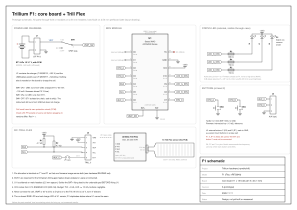
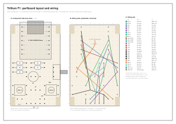
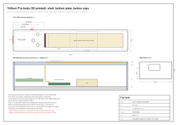
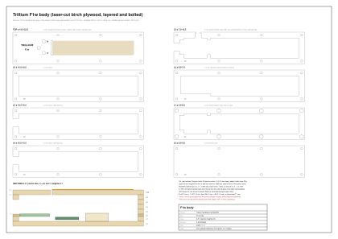

# Trillium F1 — build guide (F1p printed, F1w wood)

**Model:** F1 (T2 plus a Bela Trill Flex linear touch sensor) · **Revision:** A (prototype) · **Status:** design, not yet built

> **Naming and testing.** F1 is the planned T2 motion board plus a Bela Trill Flex linear touch sensor. This revision A design matches that: the shared core board (cell, power switch, RGB LED, buttons — the planned T2 electronics, still filed under [`t1/`](../t1/README.md)) plus the Flex parts. It has not been built. The only Flex testing to date is a breadboard [Trillium Zero (T0)](../../docs/hardware/trillium-zero.md) plus a Trill Flex. See the [model lineup](../README.md#model-lineup).

F1 adds a linear touch sensor to the planned T2 motion instrument. A Bela **Trill Flex** capacitive strip lies along the top of a 19–23 cm bar. Sliding, tapping and pressing along it are combined with tilt and strikes from the XIAO's motion sensor. The electronics are the shared **core board** plus four parts. Two bodies are designed in parallel and share the same internal layout:

| Body | Construction | Outside (L x W x H) | Visible sensor |
|---|---|---|---|
| **F1p** | 3D printed shell + bottom plate, M3 heat-set inserts | 192.8 x 36.0 x 19.0 mm | 128.5 mm |
| **F1w** | Laser-cut birch plywood, 8 layers, bolted (no glue) | 203.0 x 49.2 x 22.5 mm | 125.5 mm |

Both bodies place the core board at the USB end, the Trill base under the tail end of the strip, and the cell further along.

## 1. Schematic

These are the additions to the core board (the planned T2 electronics, [build guide in `t1/`](../t1/README.md)):

- **R1, R2 (4.7 kΩ)** pull SDA (D4) and SCL (D5) up to 3V3. Neither the Trill nor the XIAO has pull-ups on these pins. The nRF52840's internal pull-ups (11–16 kΩ) are too weak for reliable I2C.
- **J2** brings out GND, 3V3, SDA, SCL and EVT as solder pads, in Qwiic colour order (black, red, blue, yellow). The Trill's supplied Qwiic cable is cut and soldered here. A 1 x 5 right-angle header can be fitted instead for bench work.
- **JP1** (optional) links the Trill's EVT signal to D6, so that firmware can start each I2C read on a fresh scan instead of polling. On the Trill Flex, EVT is an unpopulated pad on the base, not part of the Qwiic cable. Fit JP1 only if that pad is wired to J2.5. Button C on J3 must then stay unused.

The Trill runs from the XIAO's 3V3 rail (≈ 4 mA, address 0x48). Never connect it to VBAT or 5V.

## 2. Bill of materials

**Electronics** (common to F1p and F1w):

| Ref | Qty | Value | Description | Example part |
|---|---|---|---|---|
| U1 | 1 | XIAO nRF52840 Sense | Seeed Studio XIAO nRF52840 Sense, on 2 x 7-pin male headers | Sense variant |
| BT1 | 1 | LiPo 1S | 3.7 V, 4.2 V full, built-in protection (PCM), JST-PH lead, ≤ 5 x 30 x 35 mm | 503035, ≈ 500 mAh |
| J1 | 1 | JST-PH 2 | JST-PH 2-pin plug on a wire pigtail, wires soldered into the board | matching the cell |
| SW1 | 1 | SPDT slide | Power switch, through-hole right angle, 2.5 mm pitch | C&K OS102011MA1QN1 |
| D1 | 1 | RGB 5 mm CA | 5 mm diffused RGB LED, common anode | Adafruit 159 / SparkFun COM-10821 |
| R3 | 1 | 680 Ω | LED red, 1/4 W mini, 0.3" span | generic |
| R4, R5 | 2 | 150 Ω | LED green, blue, 1/4 W mini (*tune* 82–220 Ω) | generic |
| R1, R2 | 2 | 4.7 kΩ | I2C pull-ups, 1/4 W mini, 0.3" span | generic |
| SW2, SW3 | 2 | Buttons A, B | Tactile 6 x 6 mm, through-hole, 4.3 mm high | Omron B3F-1000 |
| J2 | 1 | TRILL 5 | Wire pads (or 1 x 5 right-angle header) | — |
| J3 | 1 (opt.) | AUX 3 | External buttons C, D | generic |
| JP1 | 1 (opt.) | EVT link | Wire link J2.5 to D6 | — |
| U2 | 1 | Bela Trill Flex | Trill Flex base, 36.3 x 22.4 mm, 32-pin 0.5 mm FFC socket, I2C 0x48 | Bela 160706-FLEX |
| S1 | 1 | Flex sensor | Trill Flex 1-axis flex-PCB strip | supplied with U2 |
| W1 | 1 | Qwiic cable | JST-SH 4-pin, one end cut and soldered to J2 pads 1–4 | supplied with U2 |
| PB1 | 1 | Perfboard | 2.54 mm, cut to 11 x 18 holes | any |
| — | — | Sundries | 2 x 7-pin male headers, 28–30 AWG wire, 5 mm LED standoff, Kapton tape, foam tape | any |

**F1p mechanical:** shell and plate (printed, `f1p-body.scad`), 2 button caps (printed, same as the planned T2 / `t1/` caps), 4 x M3 heat-set inserts (5.7 mm OD, 4 mm long), 4 x M3 x 6 countersunk screws.

**F1w mechanical:** one 3 mm birch plywood sheet ≥ 430 x 220 mm, one 1.5 mm sheet ≥ 215 x 75 mm, 8 x M3 x 20 button-head screws, 8 x M3 hex nuts, wood glue for the button plungers only.

The full list with mechanical items is [`f1-bom.csv`](f1-bom.csv).

## 3. Perfboard layout and wiring

The placement is identical to the planned T2 core board. R1 (E10–H10), R2 (A11–D11), J2 (D18–H18) and JP1 (G17–H17) occupy holes that the T2 drawings leave empty.

| # | Net | From | To |
|---|---|---|---|
| 1 | `BTN_A` | U1.D2 (C3) | SW2.1 (A14) |
| 2 | `BTN_B` | U1.D3 (C4) | SW3.1 (H14) |
| 3 | `SDA` | U1.D4 (C5) | R1.1 (E10) |
| 4 | `SDA` | R1.1 (E10) | J2.3 (F18) |
| 5 | `SCL` | U1.D5 (C6) | R2.1 (A11) |
| 6 | `SCL` | R2.1 (A11) | J2.4 (G18) |
| 7 | `AUX_C` | U1.D6 (C7) | J3.1 (E15) |
| 8 | `AUX_C` | J3.1 (E15) | JP1.1 (G17) |
| 9 | `BTN_D` | U1.D7 (I7) | J3.2 (F15) |
| 10 | `LED_R_DRV` | U1.D8 (I6) | R3.1 (A9) |
| 11 | `LED_G_DRV` | U1.D9 (I5) | R4.2 (H9) |
| 12 | `LED_B_DRV` | U1.D10 (I4) | R5.1 (A10) |
| 13 | `+3V3` | U1.3V3 (I3) | R1.2 (H10) |
| 14 | `+3V3` | R1.2 (H10) | D1.A (E12) |
| 15 | `+3V3` | D1.A (E12) | R2.2 (D11) |
| 16 | `+3V3` | D1.A (E12) | J2.2 (E18) |
| 17 | `GND` | U1.GND (I2) | J3.3 (G15) |
| 18 | `GND` | J3.3 (G15) | SW2.2 (D16) |
| 19 | `GND` | SW2.2 (D16) | J1.2 (C17) |
| 20 | `GND` | SW2.2 (D16) | J2.1 (D18) |
| 21 | `GND` | J3.3 (G15) | SW3.2 (K16) |
| 22 | `VBAT` | J1.1 (B17) | SW1.1 (J10) |
| 23 | `LED_R` | D1.R (D12) | R3.2 (D9) |
| 24 | `LED_G` | D1.G (F12) | R4.1 (E9) |
| 25 | `LED_B` | D1.B (G12) | R5.2 (D10) |
| 26 | `TRILL_EVT` | J2.5 (H18) | JP1.2 (H17) |
| 27 | `VBAT_SW` | U1.BAT+ (underside pad) | SW1.2 (J11) |

Wires 7–9 and 17 go through J3: if J3 is not used, run wire 7 directly from U1.D6 to JP1.1 (only if JP1 is fitted) and wire 17 from U1.GND to SW2.2.

**Building the core board:** follow the [core-board assembly procedure](../t1/README.md#4-assembly-procedure) (planned T2, files still under `t1/`), and add R1 and R2 at step 3. Then:

- **J2 / W1.** Cut the Qwiic cable to the length the body needs: about 80 mm for F1p and F1w, from the board's inner edge to the Trill base's Qwiic socket. Keep the JST-SH end. Strip and tin the four wires and solder black → D18 (GND), red → E18 (3V3), blue → F18 (SDA), yellow → G18 (SCL). Check the colours against the Trill datasheet's Qwiic pinout (1 GND black, 2 VCC red, 3 SDA blue, 4 SCL yellow): third-party cables sometimes differ. Add a dab of hot glue for strain relief.
- **JP1 (optional).** Solder a fine wire from the EVT pad on the Trill base to J2.5 (H18) and fit the JP1 link (G17–H17). Leave J3.1 unconnected.

**Checks** (in addition to the core-board checks in the `t1/` guide, section 5): with power off, D4 (C5) → 3V3 (I3) and D5 (C6) → 3V3 read about 4.7 kΩ. With USB connected and the Trill plugged in, the existing firmware should report the Trill at 0x48 on the diagnostics port and show touch in the app's Sensors tab.

## 4. F1p — 3D printed body

Source: [`f1p-body.scad`](f1p-body.scad). Parts: `shell` (top surface and walls, printed top-down), `plate` (bottom plate, printed flat) and `caps` (same as the planned T2). `part = "assembly"` shows the contents in place.

**Before printing,** measure your sensor. Set `sensor_l` to its overall length (distributor listings give 145.5 mm for the stock strip, while Bela's revision table quotes 117 mm). Then dry-fit the tail into the Trill base's FFC socket and estimate `tail_len`: the strip length that goes through the slot, bends down and is inserted into the socket (17 mm by default). The top channel length and the body length follow from these two numbers.

**Print:** PLA or PETG, 0.2 mm layers, 3–4 perimeters, 20–25 % infill, no supports. The 12.5 mm USB opening bridges cleanly. The shell is about 193 mm long and fits a 220 mm bed diagonally or straight.

**Assembly:**

1. Press four M3 heat-set inserts into the bosses (pilot holes Ø4.0 x 5.5 mm).
2. Plate: stick the cell between its locators with foam tape, lead toward the board. Stick the Trill base between its locators, FFC socket toward the USB end, so the socket edge is at X = 57 mm from the inner end wall.
3. Plug the cell into J1 and the Qwiic cable into the Trill base. Lay the core board on the four corner posts at the USB end. The lips locate it.
4. Feed the sensor tail down through the slot in the shell's top and insert it into the Trill FFC socket: contacts facing the socket's contacts, latch closed. Check the orientation against Bela's Trill Flex guide before forcing anything.
5. Drop the two caps into their holes, then lower the shell over the plate. Hook the plate's tongue into the slot in the USB end wall first, then fit four M3 x 6 countersunk screws from below.
6. Peel the strip's backing (or apply thin double-sided tape) and lay it into the 0.4 mm channel from the slot outward, smoothing from the centre to avoid bubbles.

## 5. F1w — laser-cut wood body

Files: [`f1w-sheet-3mm.svg`](f1w-sheet-3mm.svg) (TOP, L0, L1, L3–L6 and six plunger discs, 418.5 x 217.3 mm) and [`f1w-sheet-1.5mm.svg`](f1w-sheet-1.5mm.svg) (L2 board-pocket layer and four plunger discs, 211.5 x 73.2 mm). Both are in millimetres. **Red hairlines are cuts. Black fills are raster engraves:** the sensor pocket on TOP (≈ 0.3–0.5 mm deep), the labels, and small layer IDs on hidden wall faces. All engraved text is already converted to outlines. Kerf compensation of 0.15 mm is built in. Change `kerf` in `tools/mech_params.py` and regenerate if your laser differs.

| Layer | Material | z (mm) | Function |
|---|---|---|---|
| TOP | 3 mm | 19.5–22.5 | Sensor pocket, tail slot, LED and button holes, labels |
| L6 | 3 mm | 16.5–19.5 | Frame |
| L5, L4 | 3 mm | 10.5–16.5 | Frames with USB-C opening |
| L3 | 3 mm | 7.5–10.5 | Retainer tabs press on the board's corner zones; power-switch slot (wall thinned to 2 mm); USB-C opening |
| L2 | 1.5 mm | 6.0–7.5 | Board pocket: locates the 1.6 mm board, which is clamped 0.1 mm by L3 |
| L1 | 3 mm | 3.0–6.0 | Board support tabs at the corner zones; eight M3 nut traps |
| L0 | 3 mm | 0.0–3.0 | Bottom plate |

**Before cutting,** set `sensor_l` and `tail_len` in `tools/mech_params.py` (class `F1w`; the default tail allowance is 20 mm because the drop is deeper). Run `python3 hardware/tools/gen_hw.py`, then test-cut L1 and L2 in scrap to check the nut traps and the board pocket.

**Assembly** (bottom up, no glue in the stack):

1. Lay L0 down, then L1. Drop eight M3 nuts into the hex traps. Check that every layer ID engraving sits at the same corner (−Y wall, USB end).
2. Stick the cell and the Trill base to L0 inside the cavity with foam tape, in the same positions as F1p (Trill FFC edge 57 mm from the inner USB wall).
3. Lay the wired core board on L1's four corner tabs, then fit L2 around it.
4. Stack L3 (its tabs land on the board's corners, SW1's actuator in the side slot), then L4, L5 and L6.
5. Glue up the two button plungers: Ø7 3 mm + Ø7 3 mm + Ø7 1.5 mm as the shoulder, then Ø4.6 3 mm + Ø4.6 1.5 mm as the stem. Or use the printed caps from the `t1/` (planned T2) design. Stand them on the tactile switches.
6. Feed the sensor tail through TOP's slot into the Trill FFC socket. Lower TOP over the plungers and LED, then fit eight M3 x 20 screws and tighten evenly.
7. Lay the strip into the engraved pocket.

The board's LED sits 6.3 mm above the board in F1w (2.9 mm in the planned T2 and F1p) because the wooden top is 3 mm thick and higher. Fit a longer standoff, or bend the leads, on wood builds.

**Wood finish:** seal or oil all faces except the bottom of the sensor pocket before assembly. Moisture in bare wood shifts the Trill's capacitive baseline. After the first power-up, let the sensor recalibrate (firmware resets its baseline at start-up).

## 6. Known limits of this revision

- Not yet built. Sensor length and tail allowance are taken from distributor data and must be measured.
- Sensing through extra material on the strip (veneer, vinyl, paint) has not been tested. The design leaves the strip bare in a flush channel or pocket. A thin overlay may need a lower Trill prescaler (higher sensitivity) in firmware.
- The Trill base and cell are held by foam tape. The Trill Flex base has no mounting holes.
- The cell does not charge while SW1 is OFF, and the 500 mAh cell needs firmware to select 100 mA charging to finish within the charger's 10-hour timer (see [hardware/README.md](../README.md#power-charging-and-the-on-off-switch)).
- EVT-driven reading (JP1) needs a wire to an unpopulated pad on the Trill base and firmware support.
