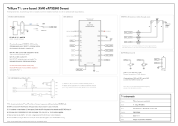
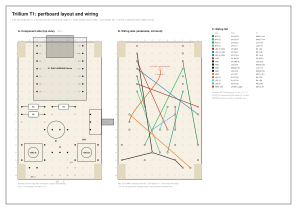
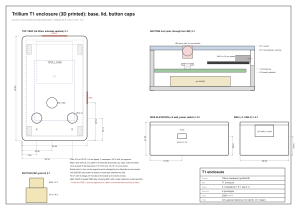

# Trillium T2 — build guide (files still labelled T1)

**Drawings labelled:** T1 · **Lineup model:** **T2** · **Revision:** A (prototype) · **Status:** design, not yet built

> **Naming.** The model lineup now uses **T0** for a bare XIAO nRF52840 Sense on a USB cable ([Trillium Zero](../../docs/hardware/trillium-zero.md)), **T1** for T0 plus a battery and BLE, and **T2** for T1 plus a better LED and buttons. This folder is still called `t1/` and the schematics, layout, BOM and enclosure files are still named `t1-*`, because they were filed that way in revision A. **The electronics and enclosure in this folder are the planned T2**, not the simpler T1. They have not been built. A T1 has been built and tested as an early Omi DIY board (battery and BLE, not this LED and button layout). A rename of this folder to `t2/` is proposed and is not done here. See the [model lineup](../README.md#model-lineup).

This is the planned next motion instrument after T1: a Seeed Studio XIAO nRF52840 Sense made self-contained with a rechargeable cell, a power switch, a status LED that shows through the case, and two buttons. It fits in a 32.5 x 52.2 x 22.1 mm printed enclosure. It works as a USB-MIDI device with or without the Trillium app. BLE is planned on the same board.

The electronics are the shared **core board** (see [hardware/README.md](../README.md)). F1 uses the same board with four extra parts. In the lineup, F1 is this T2 board plus a Bela Trill Flex linear touch sensor.

## 1. Schematic

The XIAO's own charger and USB/battery switch-over are used unchanged. SW1 breaks the cell's positive lead. **SW1 must be ON for the cell to charge.** With SW1 OFF the instrument still runs from USB but the cell is isolated. The I2C parts shown in grey (R1, R2, J2, JP1) are not fitted on this board (planned T2). Their holes stay free for an F1 upgrade.

## 2. Bill of materials

| Ref | Qty | Value | Description | Example part |
|---|---|---|---|---|
| U1 | 1 | XIAO nRF52840 Sense | Seeed Studio XIAO nRF52840 Sense (nRF52840, BLE 5, LSM6DS3TR-C IMU, PDM mic, BQ25101 Li-ion charger), soldered on 2 x 7-pin 2.54 mm male headers | Sense variant (not the non-Sense or Plus variants) |
| BT1 | 1 | LiPo 1S | Rechargeable lithium-polymer cell, 3.7 V nominal, 4.2 V full, with built-in protection circuit (PCM) and 2-pin JST-PH lead | 502030, ≈ 250 mAh (≤ 5 x 20 x 30 mm) |
| J1 | 1 | JST-PH 2 | Battery connector: JST-PH 2.0 mm 2-pin plug on a wire pigtail, wires soldered into the board (PH pitch is 2.0 mm and does not fit 2.54 mm perfboard) | JST-PH 2-pin pigtail matching the cell |
| SW1 | 1 | SPDT slide | Power switch, SPDT slide, through-hole right angle, 2.5 mm pitch | C&K OS102011MA1QN1 |
| D1 | 1 | RGB 5 mm CA | Status LED, 5 mm diffused RGB, common anode. Lead order assumed R, A (longest), G, B: confirm with a meter's diode test | Adafruit 159 / SparkFun COM-10821 |
| R3 | 1 | 680 Ω | LED red series resistor, 1/4 W mini (body ≤ 3.6 mm), 0.3" span | generic |
| R4 | 1 | 150 Ω | LED green series resistor, 1/4 W mini, 0.3" span (*tune* 82–220 Ω) | generic |
| R5 | 1 | 150 Ω | LED blue series resistor, 1/4 W mini, 0.3" span (*tune* 82–220 Ω) | generic |
| SW2 | 1 | Button A | Tactile switch 6 x 6 mm, through-hole, 4.3 mm high, wired diagonally | Omron B3F-1000 |
| SW3 | 1 | Button B | Tactile switch 6 x 6 mm, through-hole, 4.3 mm high, wired diagonally | Omron B3F-1000 |
| J3 | 1 (opt.) | AUX 3 | External buttons C (D6) and D (D7): 1 x 3 header or wire pads | generic |
| PB1 | 1 | Perfboard | 2.54 mm pitch, single-sided pads, FR-4 1.6 mm, cut to 11 x 18 holes (27.94 x 45.72 mm) | any |
| H1 | 2 | Male header 1x7 | 2.54 mm, standard 2.5 mm plastic (normally supplied with the XIAO) | any |
| W | — | Hook-up wire | 28–30 AWG insulated solid (wire-wrap) wire, several colours | any |
| SP1 | 1 | LED standoff | Plastic spacer for 5 mm LED, cut to 2.9 mm | any |
| KT1 | — | Insulating tape | Polyimide (Kapton) tape for the board underside | any |
| M1 | 1 | Enclosure base | 3D printed, `t2-enclosure.scad`, `part = "base"` | print |
| M2 | 1 | Enclosure lid | 3D printed, `part = "lid"` | print |
| M3 | 2 | Button cap | 3D printed, `part = "caps"` | print |
| M4 | — | Foam tape | Double-sided foam tape, 0.5–1 mm, for the cell | any |

The machine-readable list is [`t2-bom.csv`](t2-bom.csv). Tools: fine-tip soldering iron, flush cutters, multimeter, and a 3D printer (PLA or PETG).

## 3. Perfboard layout and wiring

Holes are named by column letter and row number, with **A1** the top-left hole on the component side and the USB-C end at the top. View B is the underside, mirrored, as you see it while wiring.

| # | Net | From | To |
|---|---|---|---|
| 1 | `BTN_A` | U1.D2 (C3) | SW2.1 (A14) |
| 2 | `BTN_B` | U1.D3 (C4) | SW3.1 (H14) |
| 3 | `AUX_C` | U1.D6 (C7) | J3.1 (E15) |
| 4 | `BTN_D` | U1.D7 (I7) | J3.2 (F15) |
| 5 | `LED_R_DRV` | U1.D8 (I6) | R3.1 (A9) |
| 6 | `LED_G_DRV` | U1.D9 (I5) | R4.2 (H9) |
| 7 | `LED_B_DRV` | U1.D10 (I4) | R5.1 (A10) |
| 8 | `+3V3` | U1.3V3 (I3) | D1.A (E12) |
| 9 | `GND` | U1.GND (I2) | J3.3 (G15) |
| 10 | `GND` | J3.3 (G15) | SW2.2 (D16) |
| 11 | `GND` | SW2.2 (D16) | J1.2 (C17) |
| 12 | `GND` | J3.3 (G15) | SW3.2 (K16) |
| 13 | `VBAT` | J1.1 (B17) | SW1.1 (J10) |
| 14 | `LED_R` | D1.R (D12) | R3.2 (D9) |
| 15 | `LED_G` | D1.G (F12) | R4.1 (E9) |
| 16 | `LED_B` | D1.B (G12) | R5.2 (D10) |
| 17 | `VBAT_SW` | U1.BAT+ (underside pad) | SW1.2 (J11) |

Wires 3, 4 and 9 to J3 are needed only if J3 is used. If it is not, run wire 9 directly from U1.GND (I2) to SW2.2 (D16).

Keep the four **corner zones** (A1–A2, K1–K2, A17–A18, K17–K18) free of parts and solder blobs. The enclosure supports and clamps the board there.

## 4. Assembly procedure

1. **Cut the board** to 11 x 18 holes. File the edges square. Check that it is 27.9 x 45.7 mm.
2. **Prepare U1.** Solder the two 7-pin headers to the XIAO, long pins down. Tin the **BAT+** pad on the XIAO's underside and solder a 60 mm red 28 AWG lead to it. Confirm polarity against Seeed's back-side photo: BAT+ is the cell positive. Do not use the BAT− pad. It is already common with GND.
3. **Fit low parts first:** R3 (A9–D9), R4 (E9–H9), R5 (A10–D10), each lying flat. Bend leads tightly at 0.3" (7.62 mm). Use mini-size 1/4 W resistors, or bend standard ones close to the body.
4. **Fit SW2 and SW3.** A B3F-style switch has a 6.5 x 4.5 mm pin pattern. It sits on the 0.3" x 0.2" grid: pins A14, D14, A16, D16 for SW2 and H14, K14, H16, K16 for SW3. The legs flex into place. Solder all four pins: two carry the signal (diagonal), two only hold the switch.
5. **Fit SW1** on J10–J12 with its actuator pointing past the right board edge. Use the body's mounting legs if your board can take them, otherwise clip them. Solder the three pins.
6. **Fit U1.** Lay the BAT+ lead flat along the board so that it leaves the gap under the XIAO on the right (column J side). Seat U1 with its pins in C1–C7 and I1–I7, USB-C overhanging the top edge, and solder. Cut the lead to length, bring it round to SW1, and solder it into J11 (SW1 common) from the component side or the underside.
7. **Fit D1** at D12 (R), E12 (anode, longest lead), F12 (G), G12 (B), standing on the 2.9 mm standoff SP1 so the dome ends flush with the lid. Confirm the lead order with a diode test first. The anode is common.
8. **Fit J1.** Solder the pigtail's red wire into B17 and black into C17, with a little slack, and add strain relief with a dab of hot glue on the component side.
9. **Wire the underside** using the wiring list. Cut every lead to ≤ 1 mm. The cell sits directly below the board.
10. **Insulate.** Cover the underside with one layer of Kapton tape.

## 5. Electrical checks before connecting the cell

With USB and the cell disconnected:

1. 3V3 (I3) to GND (I2): no short (a high resistance, normally several kΩ or more).
2. Continuity: SW2 pins A14↔D16 closed only while pressed. Same for SW3, H14↔K16.
3. SW1: common J11 connects to J10 in one position and to J12 in the other. **Mark which slider position joins J11 to J10: that is ON.**
4. Diode-test D1 from E12 (red probe) to D12, F12 and G12: each colour should glow faintly.

Then plug in USB with no cell fitted:

5. 3V3 at I3 ≈ 3.3 V. The existing firmware should enumerate as `Trill XIAO MIDI (dev)`.

Then the cell, with USB unplugged and SW1 OFF:

6. Measure the cell at its own connector: 3.0–4.2 V, red = positive. Plug it into J1, set SW1 ON: the board runs, and 3V3 ≈ 3.3 V. Plug in USB: the XIAO's red charge LED lights.

## 6. Enclosure

Source: [`t2-enclosure.scad`](t2-enclosure.scad) (OpenSCAD 2021.01 or later). Set `part` to `base`, `lid` or `caps`, render (F6) and export STL. `part = "assembly"` shows everything in place for checking.

| Part | Orientation | Notes |
|---|---|---|
| Base | Open side up | 2 mm walls and floor; corner supports for the board; cell ribs; USB-C and power-switch openings |
| Lid | Plate on the bed | Press-fit lip (0.15 mm clearance, adjust `lip_clr`); four posts clamp the board's corner zones |
| Caps (x2) | Wide end down | Ø7.0 x 4.9 mm shoulder + Ø4.6 x 3.3 mm stem; stands 1 mm proud of the lid |

Print in PLA or PETG with 0.2 mm layers, 3 perimeters and 20 % infill. No supports are needed.

Final assembly: stick the cell between the base ribs with foam tape, its lead toward the bottom (−Y) end. Plug it into J1. Lower the board onto the four corner supports, USB-C into the end opening and SW1's actuator into the side slot. Drop the caps into the lid holes, then press the lid on. Prise it off later at the notch on the −Y end. After the SW1 check in step 5.3, mark ON beside the debossed PWR label.

Set `aux_hole = true` to add a 4 mm hole in the −Y wall for wires to external buttons on J3.

## 7. Known limits of this revision

- Not yet built: fits, LED brightness, current draw and charge time are calculated, not measured.
- The cell does not charge while SW1 is OFF (see [hardware/README.md](../README.md#power-charging-and-the-on-off-switch)).
- Firmware support for the external LED and the buttons is still to be written. Until then, the XIAO's on-board LED and the USB-MIDI function work as they do today.
- The USB-C opening (12.5 mm wide, a U-notch closed by the lid) fits common cable overmoulds. Very large plugs may not fit.
